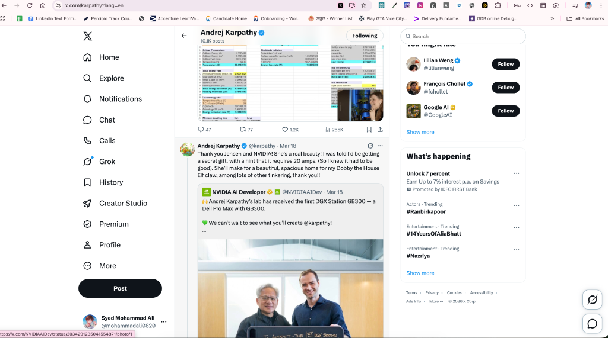

# X Sidebar Cleaner 🧹

> A lightweight, privacy-respecting cross-browser extension (Manifest V3) that removes the distracting **"What’s happening"** trending topics, hashtags, and promoted ads card from X (formerly Twitter) — while keeping **"Who to follow"**, your search bar, and the primary timeline completely intact.

---

## 📸 Visual Scope & Acceptance Reference

The extension specifically targets and hides the right-sidebar trending card outlined below:



### 🎯 What Gets Hidden
* **"What’s happening"** section header and surrounding container card.
* **Trending topics & hashtags** (`#Ranbirkapoor`, `#14YearsOfAliaBhatt`, etc.).
* **Promoted advertisements & sponsored trends** (e.g., promoted banking or product tags).
* **"Show more"** link inside the trending card.
* Unnecessary card borders and margin gaps left by the trending card.

### 🛡️ What Is Strictly Preserved
* **"Who to follow" / "You might like"** recommendation section above or below it.
* **Search bar** (`[data-testid="SearchBox_Search_Input"]`).
* **Central timeline and feeds** (`[data-testid="primaryColumn"]`).
* **Left-hand navigation menu** (Home, Explore, Notifications, Grok, Profile, etc.).
* **Footer links & copyright** (Terms, Privacy, Cookies).

---

## ✨ Features

- **⚡ Zero Flash of Unstyled Content (FOUC):** Injects declarative CSS at `document_start` so trending cards never flicker on initial page load.
- **🔄 SPA & Infinite Navigation Resilient:** Features a lightweight, debounced `MutationObserver` and native `pushState` / `popstate` listeners that seamlessly clean content as you navigate across profiles, bookmarks, and lists without requiring page reloads.
- **🔒 True Privacy First:**
  - 100% offline execution.
  - Zero external network requests or CDNs.
  - Zero telemetry, analytics, or trackers.
  - Never accesses passwords, cookies, direct messages, or user credentials.
- **🎛️ Interactive Popup Toggle:** Enable or disable the extension anytime from the browser toolbar. Changes apply instantly without reloading the page.
- **💾 Persistent State:** Remembers your preference across browser restarts using `chrome.storage.sync` (with automatic fallback to `chrome.storage.local`).
- **🛡️ Minimal Permissions:** Requests only the single `"storage"` permission for saving your toggle preference.

---

## 🌐 Supported Browsers

| Browser | Status | Engine | Manifest |
| :--- | :--- | :--- | :--- |
| **Google Chrome** | ✅ Fully Supported | Chromium | V3 |
| **Microsoft Edge** | ✅ Fully Supported | Chromium | V3 |
| **Brave** | ✅ Fully Supported | Chromium | V3 |
| **Opera / Vivaldi** | ✅ Fully Supported | Chromium | V3 |
| **Mozilla Firefox** | ⚠️ Compatible via MV2 / Firefox MV3 polyfill | Gecko | Notes below |

### Supported Domains
- `https://x.com/*`
- `https://twitter.com/*`

---

## 📂 Project Structure

```text
x-sidebar-cleaner/
├── manifest.json              # Chrome Extensions Manifest V3 definition
├── content.js                 # Content script engine with card detection & MutationObserver
├── styles.css                 # Declarative CSS hiding rules & safety overrides
├── popup.html                 # Minimal dark-mode extension popup UI
├── popup.css                  # Popup styling aligned with X dark aesthetics
├── popup.js                   # Popup toggle logic & storage sync
├── package.json               # Module resolution & automated test runner scripts
├── icons/                     # Native extension icons
│   ├── icon-16.png
│   ├── icon-32.png
│   ├── icon-48.png
│   └── icon-128.png
├── assets/                    # Visual references and screenshots
│   └── screenshot-reference.png
├── tests/                     # Automated unit and integration test suite
│   ├── manifest.test.js       # Manifest V3 schema and permission validator
│   └── cleaner.test.js        # DOM detection, boundary resolution & preservation tests
├── LICENSE                    # MIT License
├── .gitignore                 # Standard repository ignores
└── README.md                  # Comprehensive documentation
```

---

## 🚀 Installation Instructions (Load Unpacked)

### 1. Google Chrome
1. Open Google Chrome and enter `chrome://extensions` in the address bar.
2. In the top-right corner, switch the **Developer mode** toggle to **ON**.
3. In the top-left menu, click **Load unpacked**.
4. Select the `x-sidebar-cleaner` directory.
5. Navigate to [x.com](https://x.com) to verify that the "What’s happening" section is gone while "Who to follow" remains visible.

### 2. Microsoft Edge
1. Open Edge and navigate to `edge://extensions`.
2. In the left sidebar, turn ON **Developer mode**.
3. Click the **Load unpacked** button at the top of the page.
4. Select the `x-sidebar-cleaner` folder.
5. Open X and verify.

### 3. Brave Browser
1. Open Brave and go to `brave://extensions`.
2. Toggle **Developer mode** to ON in the upper-right corner.
3. Click **Load unpacked**.
4. Choose the `x-sidebar-cleaner` directory.

---

## 🎛️ How to Enable & Disable

1. Click the **puzzle piece icon** in your browser toolbar and pin **X Sidebar Cleaner**.
2. Click the **X Sidebar Cleaner** icon to open the popup.
3. Toggle the **Block "What's happening"** switch:
   - **Active (Green):** Trending topics and promoted ads are hidden.
   - **Paused (Gray):** The trending sidebar is immediately restored without needing to reload or restart your browser.

---

## 🔄 Updating After Pulling New Code

Whenever you pull changes from the Git repository:
1. Open your browser's extensions page (`chrome://extensions` or `edge://extensions`).
2. Locate **X Sidebar Cleaner**.
3. Click the circular **Reload** icon on the extension card.
4. Refresh your active X tab.

---

## 🧪 Testing and Verification

This project includes automated test coverage validating Manifest V3 compliance, permissions hygiene, DOM boundary detection, and dynamic state restoration.

### Running Tests Locally
Ensure you have Node.js (v18+) installed:

```bash
# Run the automated test suite
npm test
```

### Verified Test Cases:
* `manifest.json conforms to Chrome Manifest V3 specifications`
* `cleaner detects and hides the "What’s happening" card with curly apostrophe (’)`
* `cleaner detects and hides the "What's happening" card with straight apostrophe (')`
* `cleaner handles missing sidebar gracefully without errors`
* `toggling off restores hidden elements immediately`
* `who to follow, user cells, and search inputs are strictly protected from hiding`

---

## 🦊 Firefox Compatibility Notes

Firefox currently supports Manifest V3 with subtle differences in background service workers and extension IDs:
- In Chromium, `service_worker` or standalone content scripts operate under MV3 without an explicit `browser_specific_settings` block.
- For Firefox testing or packaging:
  1. Add a `browser_specific_settings.gecko.id` key to `manifest.json` (e.g. `"x-sidebar-cleaner@syedmohammadali"`).
  2. Load via `about:debugging` -> **This Firefox** -> **Load Temporary Add-on...** selecting `manifest.json`.
- The core DOM cleaning engine (`content.js` and `styles.css`) is 100% vanilla Web APIs and works identically across all modern rendering engines (Blink, WebKit, Gecko).

---

## 🔒 Privacy & Permissions Disclosure

- **`storage` permission:** Used solely to store your enabled/disabled toggle preference locally via `chrome.storage.sync` (or `chrome.storage.local`).
- **`host_permissions` (`https://x.com/*`, `https://twitter.com/*`):** Needed exclusively to inject the stylesheet and content script into X web pages.
- **No Remote Code:** Strictly adheres to Google Chrome Web Store policies. No external scripts or `eval()` are used.
- **Zero Data Collection:** Does not collect, log, or transmit any user information or browsing history.

---

## 🛠️ Troubleshooting

- **Trending topics still visible after install?**
  Hard-refresh your active tab (`Ctrl + Shift + R` or `Cmd + Shift + R`) to ensure the content script is injected into existing pages.
- **Did X change its layout?**
  X frequently updates its React DOM. This extension employs a multi-tier fallback mechanism:
  1. Semantic ARIA query (`[aria-label="Timeline: Trending now"]`).
  2. Heading text pattern matching (`/^what[’']s happening$/i`).
  3. Structural trend item presence (`[data-testid="trend"]`).
  If X modifies these selectors, open an issue on the GitHub repository with a DOM snippet.

---

## 🔮 Future Improvements

- [ ] Optional toggle to hide "Who to follow" for users wanting an entirely distraction-free sidebar.
- [ ] Keyboard shortcut to toggle visibility on the fly (`Alt + Shift + X`).
- [ ] Configurable keywords blocklist for custom timeline filters.

---

## 📄 License

Distributed under the **MIT License**. See [`LICENSE`](LICENSE) for more information.

Developed by [Syed Mohammad Ali](https://github.com/mohammadali-2000).
